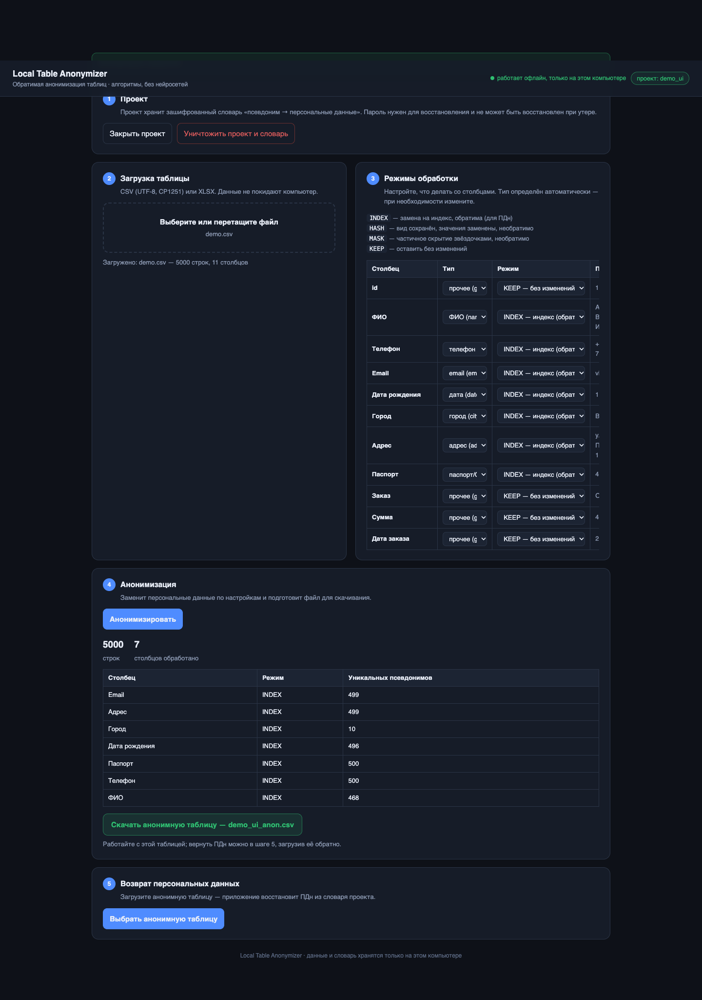
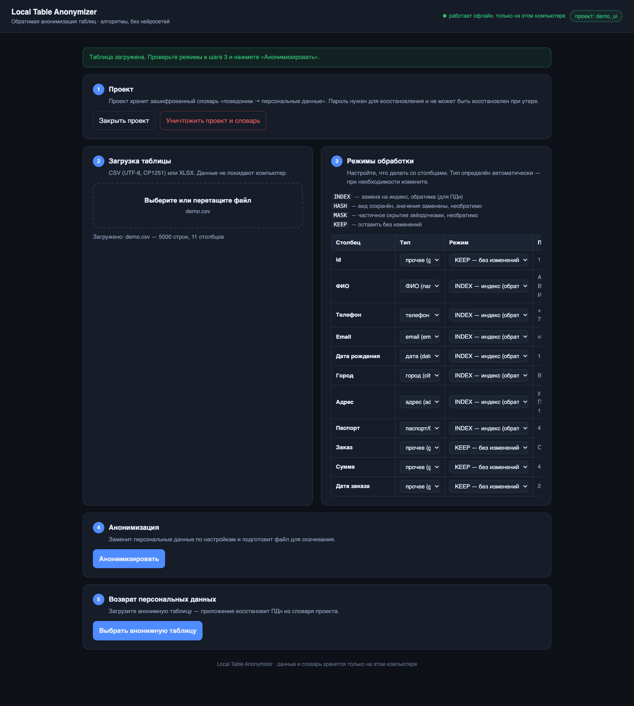
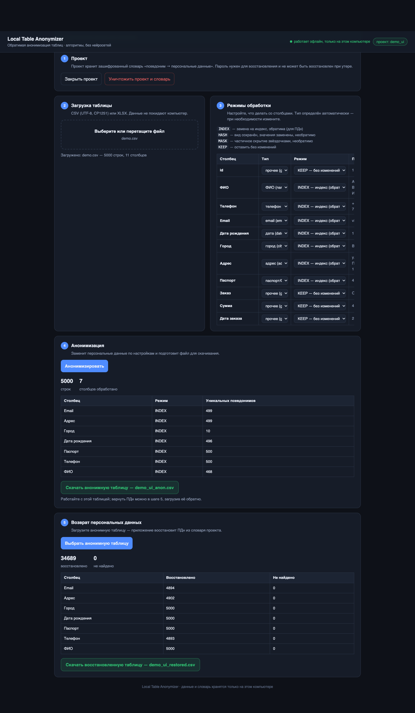
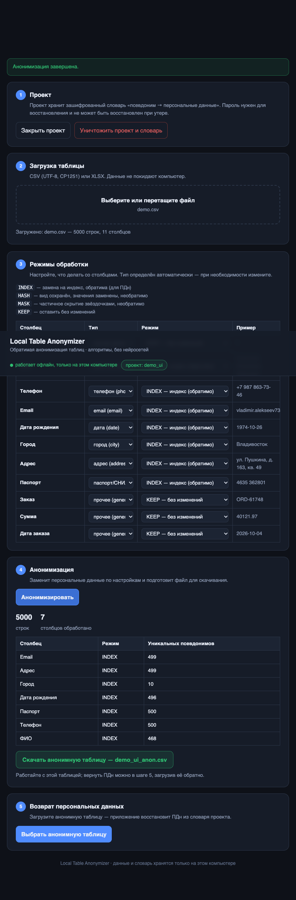
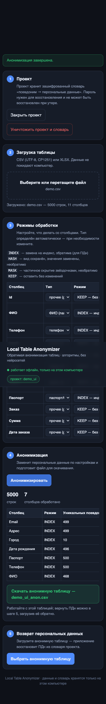
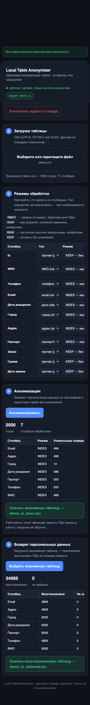
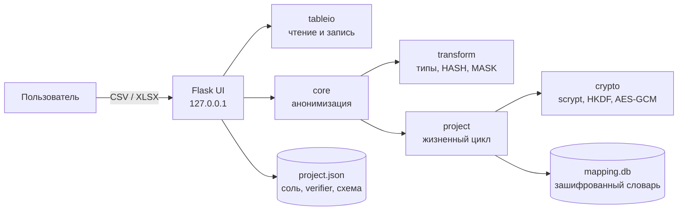

[](https://github.com/elstar883/local-table-anonymizer/actions/workflows/tests.yml)
[](LICENSE)
[](pyproject.toml)
[](requirements.txt)
[](lta/crypto.py)
[](SECURITY.md)
[](AGENTS.md)

# Local Table Anonymizer (LTA)

Локальный анонимизатор табличных данных: заменяет персональные данные в CSV и
XLSX на детерминированные псевдонимы, а затем при необходимости восстанавливает
исходные значения из зашифрованного словаря.

Приложение работает полностью офлайн, не использует нейросети и не отправляет
данные в сеть. Вся обработка идёт на `127.0.0.1`, словарь хранится только в
зашифрованном виде.



---

## Содержание

- [Проблема](#проблема)
- [Что умеет приложение](#что-умеет-приложение)
- [Быстрый старт](#быстрый-старт)
- [Скриншоты](#скриншоты)
- [Как это устроено](#как-это-устроено)
- [Режимы обработки](#режимы-обработки)
- [Криптография и словарь](#криптография-и-словарь)
- [Безопасность](#безопасность)
- [Workflow OpenCode](#workflow-opencode)
- [Проверки и CI](#проверки-и-ci)
- [Структура проекта](#структура-проекта)
- [Стек](#стек)
- [Доступность и адаптивность](#доступность-и-адаптивность)
- [Ограничения](#ограничения)
- [Дорожная карта](#дорожная-карта)
- [История изменений](#история-изменений)
- [Лицензия](#лицензия)
- [Автор](#автор)

---

## Проблема

Аналитикам, подрядчикам и поддержке часто нужна таблица с реальными строками:
чтобы построить отчёт, проверить гипотезу или передать данные на обработку.
Но в таких таблицах почти всегда есть ФИО, телефоны, email, адреса и паспортные
данные. Отправлять их наружу нельзя, а полное удаление столбцов ломает связи
между строками и делает анализ бессмысленным.

Обычные маскирование и хэширование решают задачу только наполовину: исходные
значения после них не восстановить. LTA делает замену **обратимой**:

1. персональные данные заменяются на псевдонимы `NAME_A1B2C3D4`;
2. одинаковые значения получают одинаковый псевдоним;
3. таблицу можно безопасно анализировать и передавать;
4. при необходимости приложение восстанавливает исходные значения байт-в-байт
   по зашифрованному словарю проекта.

Пароль от проекта знает только владелец данных. Без пароля словарь бесполезен.

## Что умеет приложение

### Проекты и ключи

- Создание проекта с паролем (минимум 8 символов).
- Открытие существующего проекта с проверкой пароля через KDF-верификатор.
- Отдельный ключ проекта: одинаковые значения в разных проектах получают
  разные псевдонимы.
- Уничтожение проекта с перезаписью словаря случайными данными.
- Список локальных проектов в интерфейсе.

### Импорт таблиц

- CSV: UTF-8 с BOM, UTF-8 и CP1251.
- Автоопределение разделителя: `,`, `;`, табуляция.
- XLSX и XLSM: чтение активного листа без макросов.
- Автоопределение типа столбца по заголовку и значениям: ФИО, телефон, email,
  дата рождения, адрес, город, паспорт/СНИЛС, прочее.
- Показ примера значения и режима для каждого столбца.

### Анонимизация

- Четыре режима: `INDEX`, `HASH`, `MASK`, `KEEP`.
- Детерминированные псевдонимы с префиксом (`NAME_`, `TEL_`, `MAIL_`, `ADDR_`,
  `PSP_`, `DOB_`, `CITY_`, `ID_`).
- Нормализация перед хэшированием: телефоны приводятся к цифрам, email — к
  нижнему регистру, пробелы схлопываются.
- Обработка дубликатов: одно и то же значение получает один и тот же псевдоним.
- Разрешение редких коллизий счётчиком.
- Прогресс обработки и отчёт по столбцам.
- Экспорт результата в CSV или XLSX.

### Восстановление

- Загрузка анонимной таблицы обратно в приложение.
- Восстановление только `INDEX`-столбцов по словарю.
- Отчёт: сколько значений восстановлено и сколько не найдено.
- Ненайденные значения остаются как есть — данные не портятся.
- Восстановление не зависит от порядка строк: связь идёт по псевдониму.

### Приватность

- Никаких сетевых запросов во время работы.
- Только loopback-интерфейс `127.0.0.1` и случайный токен в URL.
- Весь HTML, CSS и JavaScript встроены в приложение.
- Словарь соответствий шифруется AES-256-GCM.
- Пароль не хранится: из него выводится ключ через scrypt.

## Быстрый старт

Требуется Python 3.11 или новее.

```bash
git clone https://github.com/elstar883/local-table-anonymizer.git
cd local-table-anonymizer

python3 -m venv .venv
source .venv/bin/activate
pip install -r requirements-dev.txt

# Синтетическая таблица на 5000 строк (реальные ПДн не нужны)
python3 scripts/make_demo.py 5000 demo.csv

python3 main.py
```

Откройте <http://127.0.0.1:8765/>. Порт можно изменить:

```bash
python3 main.py 9000
```

Данные приложения по умолчанию лежат в:

```text
~/Library/Application Support/LocalTableAnonymizer/
├── projects/   # каталоги *.lta с project.json и mapping.db
└── uploads/    # загруженные и экспортированные таблицы
```

Для изолированного запуска или тестов можно переопределить каталог:

```bash
LTA_DATA_DIR=/tmp/lta-demo python3 main.py
```

Команды Make:

```bash
make install   # установить зависимости
make demo      # создать demo.csv
make run       # запустить приложение
make test      # юнит-тесты
make e2e       # сквозной HTTP-тест
make validate  # проверка структуры и ограничений
make check     # validate + test + e2e
```

## Скриншоты

### Desktop, 1440 px






### Планшет, 768 px



### Мобильный, 390 px





## Как это устроено



### Слои

| Модуль | Ответственность |
|---|---|
| `main.py` | точка входа, выбор порта |
| `lta/app.py` | Flask-маршруты, встроенный интерфейс, задания с прогрессом |
| `lta/core.py` | потоковые функции анонимизации и деанонимизации |
| `lta/transform.py` | определение типа, нормализация, HASH, MASK, префиксы |
| `lta/project.py` | создание/открытие/уничтожение проекта, словарь |
| `lta/crypto.py` | scrypt, HKDF, AES-256-GCM, HMAC, верификатор |
| `lta/tableio.py` | чтение и запись CSV/XLSX |

### Поток данных

1. Пользователь создаёт проект. Генерируется соль, из пароля выводится
   мастер-ключ, в `project.json` сохраняются параметры KDF и верификатор.
2. Загружается таблица. `tableio` определяет кодировку и разделитель, а
   `transform.guess_kind` предлагает тип каждого столбца.
3. Для `INDEX`-столбца значение нормализуется и превращается в псевдоним:
   `PREFIX_` + первые 8 hex-символов HMAC-SHA256. Оригинал шифруется AES-GCM и
   попадает в `mapping.db` вместе с HMAC канонического значения.
4. Повторная встреча того же значения возвращает уже существующий псевдоним.
5. При деанонимизации приложение ищет псевдоним в словаре, расшифровывает
   оригинал и подставляет его обратно.
6. `HASH` и `MASK` необратимы по определению: в словарь они не попадают.

## Режимы обработки

| Режим | Что делает | Обратим? | Пример |
|---|---|---|---|
| `INDEX` | полная замена на псевдоним | да, по словарю | `Иванов Иван` → `NAME_A1B2C3D4` |
| `HASH` | детерминированная замена с сохранением вида | нет | `+7 916 123-45-67` → `+7 481 902-31-08` |
| `MASK` | частичное скрытие звёздочками | нет | `ivanov@mail.example` → `i***v@m***.example` |
| `KEEP` | оставить без изменений | — | `ORD-61748` |

`INDEX` — режим по умолчанию для распознанных ПДн. `KEEP` — для обычных
столбцов: идентификаторов заказов, сумм, дат заказа.

`HASH` сохраняет цифры цифрами, латиницу латиницей, знаки препинания — знаками
препинания. Кириллица заменяется на `*`, чтобы форма не выдавала исходные буквы.
`HASH` полезен, когда нужна стабильная псевдонимизация без словаря, например для
тестовых окружений.

## Криптография и словарь

| Параметр | Значение |
|---|---|
| KDF | scrypt, `N=2^16`, `r=8`, `p=1`, `dklen=32` |
| Соль | 16 случайных байт на проект |
| Производные ключи | HKDF-SHA256 с `info`: `mapping`, `canon-index`, `col:<имя>`, `verify` |
| Шифрование словаря | AES-256-GCM, 12-байтовый nonce на запись |
| Псевдоним | `PREFIX_` + первые 8 hex HMAC-SHA256, верхний регистр |
| Проверка пароля | `SHA-256(HKDF(master, "verify"))` |
| Уничтожение | перезапись `mapping.db` случайными байтами + удаление каталога |

`project.json` содержит только метаданные: версию, соль, параметры KDF,
верификатор и схему столбцов. Персональных данных там нет. `mapping.db` хранит
псевдоним, HMAC канонического значения и зашифрованный оригинал. Без пароля
расшифровать оригинал нельзя.

## Безопасность

- Приложение слушает только `127.0.0.1`, никогда `0.0.0.0`.
- Flask-сервер генерирует случайный токен и требует его во всех `/api/` и
  `/download/` маршрутах.
- Интерфейс не загружает внешние шрифты, картинки, CDN или аналитику.
- Во время обработки не выполняется сетевых вызовов; тест `test_offline`
  блокирует `socket.connect` и `socket.getaddrinfo`.
- Словарь шифруется на уровне значений, а не только файла.
- Пароль не хранится и не может быть восстановлен.

### Что важно понимать

- **Загруженные и экспортированные файлы лежат в `uploads/` в открытом виде.**
  Шифруется словарь, а не исходные таблицы. Используйте шифрование диска и
  удаляйте ненужные файлы.
- **Потеря пароля означает потерю возможности восстановления.** Резервной копии
  ключа нет.
- **Уничтожение проекта — best effort.** Перезапись файла снижает шанс
  восстановления, но SSD, снапшоты и резервные копии могут хранить старые
  блоки. Для гарантированного стирания нужны средства ОС.
- **Модель угроз — защита от случайной утечки и от передачи таблицы наружу.**
  Приложение не защищает от вредоносного ПО, кейлоггера, дампа памяти или
  злоумышленника, который знает пароль и имеет доступ к компьютеру.
- **Слабый пароль можно подобрать.** scrypt замедляет перебор, но не заменяет
  менеджер паролей.

Подробнее: [SECURITY.md](SECURITY.md).

## Workflow OpenCode

Проект оформлен по воспроизводимой методике OpenCode:

1. `/lta-plan` — разобрать требования, инварианты и риски, не меняя файлы.
2. Человек подтверждает объём этапа и спорные решения.
3. `/lta-build` — реализовать согласованный этап.
4. `/lta-qa` — независимый аудит без автоматических исправлений.
5. Исправления — только после согласования.

Правила проекта и карта репозитория описаны в [AGENTS.md](AGENTS.md).
Повторяемая методика — в
[`.opencode/skills/local-table-anonymizer/SKILL.md`](.opencode/skills/local-table-anonymizer/SKILL.md).
Команды — в [`.opencode/commands/`](.opencode/commands/).

`opencode.example.json` показывает подключение MCP через переменную окружения
`ZEROCODER_MCP_TOKEN`. Настоящий `opencode.json`, `.env` и токены в репозиторий
не попадают: они перечислены в `.gitignore`.

## Проверки и CI

Локально:

```bash
python3 scripts/validate.py   # структура, инварианты, секреты, офлайн
python3 tests/test_lta.py     # 6 юнит-тестов
bash scripts/e2e.sh           # полный сценарий через HTTP API
```

Что проверяется:

| Проверка | Результат |
|---|---|
| Round-trip `INDEX`-столбцов | исходные значения совпадают байт-в-байт |
| Детерминированность | два запуска дают одинаковые псевдонимы |
| Разные проекты | разные ключи дают разные псевдонимы |
| Неверный пароль | отказ `WrongPassword` |
| `HASH` / `MASK` | необратимы, `HASH` детерминирован |
| Офлайн | сетевые вызовы заблокированы и не происходят |
| CSV round-trip | заголовки и строки сохраняются |
| E2E | 5000 строк, 7 `INDEX`-столбцов, 0 расхождений |
| Браузер | 1440, 768, 390 и 360 px, без горизонтального переполнения |

CI — GitHub Actions, `.github/workflows/tests.yml`: Python 3.11, 3.12 и 3.13,
матрица запускает `validate`, юнит-тесты и E2E. Отчёты и доказательства:
[docs/QA-CHECKLIST.md](docs/QA-CHECKLIST.md) и
[references/acceptance-report.md](references/acceptance-report.md).

## Структура проекта

```text
.
├── lta/                         # пакет приложения
│   ├── app.py                   # Flask UI и API
│   ├── core.py                  # анонимизация и деанонимизация
│   ├── crypto.py                # scrypt, HKDF, AES-GCM, HMAC
│   ├── project.py               # проект, словарь, уничтожение
│   ├── tableio.py               # CSV/XLSX
│   └── transform.py             # типы, нормализация, HASH, MASK
├── tests/
│   ├── test_lta.py              # юнит-тесты
│   └── api_test.py              # сквозной HTTP-сценарий
├── scripts/
│   ├── make_demo.py             # синтетическая таблица
│   ├── e2e.sh                   # запуск сервера + E2E
│   └── validate.py              # проверка структуры и ограничений
├── docs/
│   ├── ARCHITECTURE.md          # архитектура и поток данных
│   ├── QA-CHECKLIST.md          # автоматическая и ручная проверка
│   └── images/                  # скриншоты desktop, tablet, mobile
├── references/
│   ├── requirements.md          # исходное ТЗ, только чтение
│   └── acceptance-report.md     # отчёт о приёмке
├── .github/workflows/tests.yml  # CI
├── .opencode/                   # команды и skill
├── AGENTS.md
├── SECURITY.md
├── CHANGELOG.md
├── CONTRIBUTING.md
├── requirements.txt
├── pyproject.toml
├── Makefile
└── main.py
```

`references/requirements.md` — исходное техническое задание. Оно доступно
только для чтения и не переписывается под реализацию.

## Стек

- **Python 3.11+** — язык приложения.
- **Flask 3.1** — локальный HTTP-интерфейс.
- **cryptography** — scrypt, HKDF, AES-256-GCM.
- **openpyxl** — чтение и запись XLSX.
- **SQLite** (stdlib) — словарь псевдонимов.
- **GitHub Actions** — CI на Python 3.11, 3.12, 3.13.

Никаких фреймворков для ML, pandas, внешних API и сетевых клиентов в runtime нет.

## Доступность и адаптивность

- Семантические `header`, `main`, `section`, `table`, `progress`.
- Подписи у полей и кнопок, `aria`-атрибуты у прогресса.
- Видимый фокус, работа с клавиатуры, Enter в поле пароля.
- Контрастная тёмная тема.
- Таблица режимов и отчёты прокручиваются внутри карточки на узких экранах,
  не растягивая страницу.
- Проверены ширины 1440, 768, 390 и 360 px; горизонтального переполнения нет.

## Ограничения

Это учебный MVP, а не промышленная DLP-система. Честные ограничения:

- **Нет настоящей потоковой обработки.** Файл читается в память целиком;
  прогресс обновляется порциями. Файлы до 500 МБ / 1 млн строк — в дорожной
  карте.
- **Нет кнопки отмены** длительной операции.
- **Смена пароля не выведена в UI.** Метод `Project.change_password()` есть в
  слое хранения, но маршрута и кнопки пока нет.
- **Минимальная длина пароля — 8 символов**, без оценки энтропии и требования
  ≥ 10 символов из ТЗ.
- **Нет блокировки после неудачных попыток** ввода пароля.
- **Нет предпросмотра первых 20 строк**; показываются примеры значений по
  столбцам.
- **Нет i18n**: интерфейс на русском.
- **Нет сборки PyInstaller** и нативного установщика.
- **Нет метаданных XLSX** (время обработки, имя проекта).
- **Уничтожение словаря не гарантирует forensic-стирание** на SSD и в
  резервных копиях.
- **Один активный проект** на процесс сервера.

## Дорожная карта

- [ ] Потоковое чтение CSV и отмена заданий.
- [ ] Смена пароля в UI с перешифровкой словаря.
- [ ] Оценка энтропии пароля, минимум 10 символов.
- [ ] Блокировка после трёх неудачных попыток на 60 секунд.
- [ ] Предпросмотр первых 20 строк.
- [ ] Метаданные XLSX без ПДн.
- [ ] PyInstaller-сборка для macOS и Windows.
- [ ] Английская локализация.
- [ ] Экспорт отчёта об обработке без ПДн.

## История изменений

См. [CHANGELOG.md](CHANGELOG.md). Текущая версия — `1.0.0`.

## Лицензия

Проект распространяется по лицензии [MIT](LICENSE).

## Автор

Elsa · [GitHub @elstar883](https://github.com/elstar883)

Учебный проект по теме локальной обработки персональных данных. Все имена,
телефоны, адреса, паспорта и суммы в демонстрационных данных синтетические.
